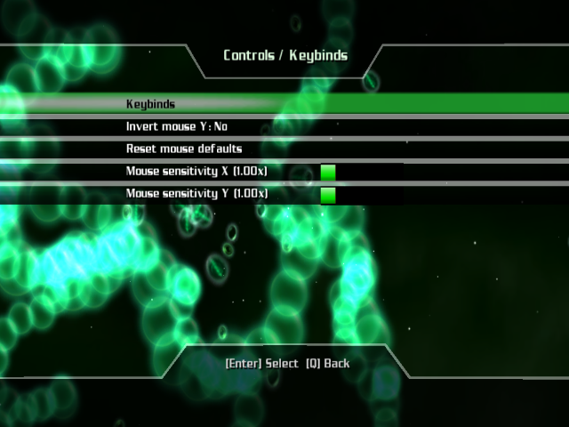
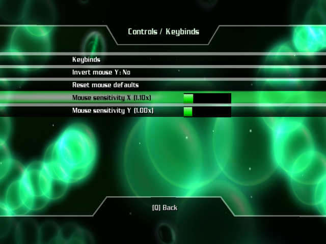

# Controls and Keybinds: test results

Controls and Keybinds use the game's Dolly menu system in main-menu and pause-menu Options. They follow Display's `OnSelect gotoscreen` entry, fonts, background, selection bars and navigation. Sensitivity uses Audio Options' `AddHSlider`; prompts use `FEDialog` and `FEpopUp`.

The game fills all 64 screen slots. Combining the eight cheat selectors on one page frees a slot for Controls. Keybinds uses the same `FEMenu` factory with separate storage and hooks for lookup, initialization and cleanup. Every cheat and Code Input remains available. A test checks creation with all slots occupied, repeated lookup, reload and deletion.

## Use

Open **Options > Controls / Keybinds > Keybinds**. Select an action, choose **Primary** or **Alternate**, then press a key, mouse button or wheel direction. **More...** offers Add and Unbind. Conflicts offer Replace, Keep both and Cancel. Escape/controller B cancels capture.

The Controls page has X/Y sensitivity sliders and invert Y. Each page has its own reset: mouse settings or bindings. Changes save to `settings.toml`. See the [configuration reference](../../README.md#pc-controls).

## Reproduce

EU and USA builds passed, along with all 12 CTest tests. Tests cover mouse input, TOML settings, both menu layouts, every binding action, capture/cancel, conflicts, multiple inputs, reset and screen cleanup.

To capture the menus on Windows using your extracted game files:

```powershell
.\tools\Test-NativeControls.ps1 -Build 'D:\Projects\Build Cache\Hulk Recompiled\release'
```

The script copies the executable/DLL to a D: test folder, links the game assets, and keeps saves and logs there. It hides all game windows, disables cursor capture and physical input, and runs an internal input recording. Audio samples are discarded without opening an XAudio2 device. Window visibility and foreground checks are saved to `safety.json`. Images come from the game's D3D11 `final.bmp` output.

Screen commands call the same operation as `FEDoScreen::Execute`. Capture/reset commands call the production menu handlers; binding candidates use the same capture handler as Win32 input. Pad events operate the game's selectors and dialogs. This tests the game menu without sending desktop input. Do not set `HULK_BACKGROUND_TEST=1` for normal play.

## Screenshots

These frames are from the EU game. USA was built and tested but not run for screenshots.

| Controls / Keybinds parent | Keybinds page |
| --- | --- |
|  |  |

Select an action row to choose its input slot in the game's popup:


The hidden run tested the X slider (1.00x to 1.10x, Y unchanged), Primary capture, the conflict popup, Keep both, cancel while holding B, the next action page, keybind-only reset, mouse-only reset and reopening Keybinds. After resetting bindings, Move Forward returned to W while mouse X stayed at 1.10x; resetting mouse then restored X/Y to 1.00x. The final settings file contained both axes at `1.0`, `move_up = ['W']` and `move_down = ['S']`. EU/USA tests also passed for alternate inputs, adding/unbinding inputs, the other conflict choices and cancellation on focus loss.

| Keep both | Keybind reset preserves mouse settings | Mouse reset |
| --- | --- | --- |
|  |  |  |

More frames: [Display reference](native-display.png), [Options entry](native-options.png), [sensitivity change](native-sensitivity.png), [capture](native-capture.png), [conflicts](native-conflict.png), [binding reset confirmation](native-reset.png), [next binding page](native-actions-page2.png), [binding defaults restored](native-keybinds-reset-applied.png), [mouse reset confirmation](native-mouse-reset.png), [Keybinds reopened](native-keybinds-reopened.png).

The 166-second run recorded **1,429 window checks with no visible game window or focus grab**. Audio stayed muted. A separate hidden restart verified loading changed sensitivity and shared bindings from the config. [Build, source and image hashes](manifest.json) identify the tested files.

Known limits: game hints still show default keys. The camera's speed and acceleration limits can make it keep moving briefly after a fast swipe. Camera feel has not been tested on the reporter's hardware.
