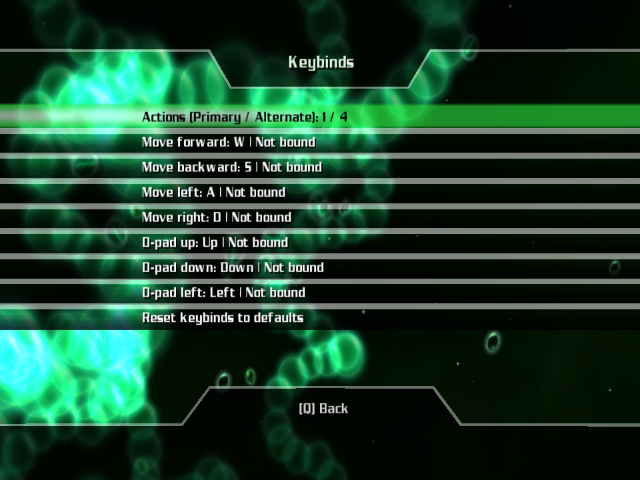
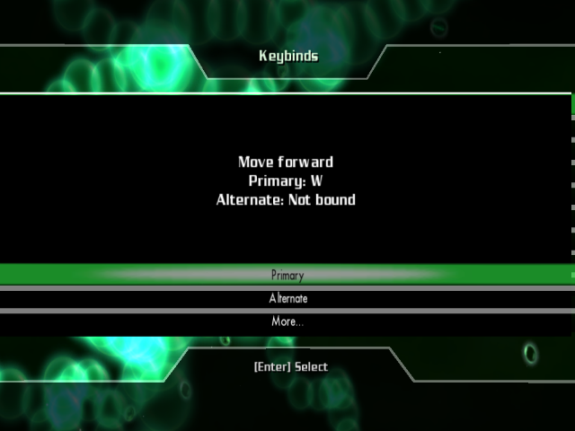
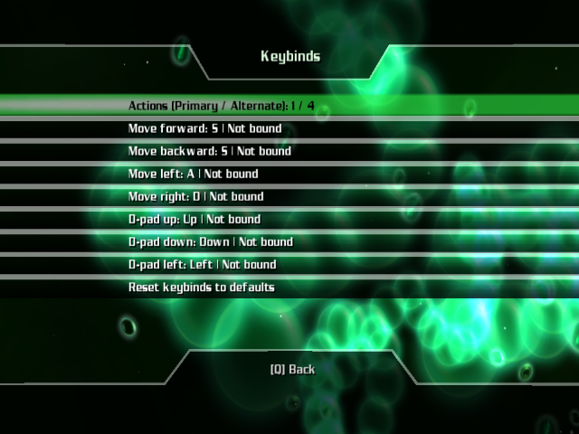
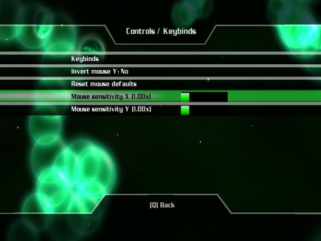

# Native Controls verification

Controls and its dedicated Keybinds submenu are Dolly frontend pages in both main-menu and pause-menu Options. The entry is `OnSelect gotoscreen "pc_controls"`, exactly like Display Options. Its title, fonts, background, row macros, pause selection bars, transitions and bottom navigation prompt come from the game's existing frontend. Sensitivity uses the original Audio Options `AddHSlider` widget and meter locators. Capture, conflicts, unbind and reset use the game's `FEDialog` and `FEpopUp` widgets. There is no host renderer or ImGui Controls implementation.

The retail frontend embeds 64 screen slots. All eight cheat selectors share one Cheats page, preserving every cheat and Code Input. The additional Keybinds screen is created by the same native FEMenu factory, with one extra owned reference rather than overwriting any retail slot. Native lookup hooks find it; frontend reset/destruction deletes it with the game's own deleting destructor. A lifecycle test checks a full 64-slot cache, repeated lookup, reload and cleanup without duplicate allocation or double deletion.

## Use

Open **Options > Controls / Keybinds**, then **Keybinds**. The dedicated page lists seven action rows with **Primary | Alternate** values; four native pages cover all 28 actions. Select a row and choose Primary/Alternate before capture. **More...** exposes Add and Unbind while retaining arbitrary multi-binds in the config. Capture accepts keys, mouse buttons and wheel directions; Escape/controller B cancels. Conflicts offer Replace/Keep both/Cancel. Held cancel inputs stay consumed until release, so they cannot back out of the page underneath.

Mouse X/Y sliders and invert Y stay on the parent page. The labels show multipliers from 0.1 to 5.0. The parent's reset changes only mouse settings; the Keybinds reset changes only bindings. Both ask for confirmation. The existing `settings.toml` format and legacy scalar migration remain compatible. [Configuration reference](../../README.md#pc-controls).

## Reproduce

Build both releases, then run CTest. The EU and USA native Controls tests exercise caption updates, every action page, independent sliders, capture/cancel/focus loss, conflict choices, multi-binds, unbind, reset and persistence requests. The real-archive test checks main/pause Options links, native script widgets, string tables and the 64-screen limit. Other tests cover mouse displacement/polling/lifecycle and TOML serialization.

For actual game-renderer frames on Windows, with your own extracted game files:

```powershell
.\tools\Test-NativeControls.ps1 -Build 'D:\Projects\Build Cache\Hulk Recompiled\release'
```

The fixture copies only the built executable/DLL into an isolated D: run folder and links the supplied extracted assets; saves and logs stay in the isolated run folder. It uses internal pad/capture events and native frontend callbacks; it never sends desktop input. It explicitly disables splash/compiler/error windows, window show/activation, display-mode changes, physical controllers/rumble and cursor capture. The audio mixer advances streaming cursors while discarding samples, without initializing an XAudio2 output device. It records window visibility/foreground checks in `safety.json`. Captures are the game's own D3D11 `final.bmp`, not desktop screenshots, component renders or mockups.

Native screen fixture commands use the same frontend virtual operation as `FEDoScreen::Execute`; capture/reset commands enter the production frontend callback handler. Binding candidates enter the same capture boundary as Win32 input. Pad events operate the actual native selectors/dialogs. Automated callback tests additionally cover choices that are not all shown in the screenshots.

Normal gameplay does not enable this fixture. Do not set `HULK_BACKGROUND_TEST=1` for ordinary play. Existing guest tooltips still name default keys, and the native camera's angular speed/acceleration limit can leave a tail after a fast swipe. Subjective camera feel on the issue reporter's hardware has not been measured.

## Recorded native pages

These are native EU game-renderer frames. Controls and Keybinds are separate pages, using the same game fonts, scene, selection bars, transitions and navigation as Display.

| Controls / Keybinds parent | Dedicated Keybinds page |
| --- | --- |
|  |  |

Select an action row to choose its input slot in the game's popup:



The hidden run exercised the native X slider (1.00x to 1.10x, Y unchanged), Primary capture, the conflict popup, Keep both, cancel while holding B, the next action page, keybind-only reset, mouse-only reset and reopening Keybinds. After resetting bindings, Move Forward returned to W while mouse X stayed at 1.10x; resetting mouse then restored X/Y to 1.00x. The final settings file contained both axes at `1.0`, `move_up = ['W']` and `move_down = ['S']`. Alternate editing, additional inputs, unbind, other conflict choices and focus-loss cancellation also pass the EU/USA callback tests.

| Keep both | Keybind reset preserves mouse settings | Mouse reset |
| --- | --- | --- |
|  |  |  |

More frames: [Display reference](native-display.png), [Options entry](native-options.png), [sensitivity change](native-sensitivity.png), [capture](native-capture.png), [conflicts](native-conflict.png), [binding reset confirmation](native-reset.png), [next binding page](native-actions-page2.png), [binding defaults restored](native-keybinds-reset-applied.png), [mouse reset confirmation](native-mouse-reset.png), [Keybinds reopened](native-keybinds-reopened.png).

The final 166-second run recorded **1,429 visibility/foreground checks and zero violations**. The game mixer discarded all samples without creating an XAudio2 device. A separate hidden restart previously verified loading changed sensitivity and shared bindings from the same config backing store. USA has build and callback-test coverage; these screenshots are EU. The camera's subjective feel on the issue reporter's hardware is not claimed. [Artifact, source and image hashes](manifest.json) identify the verified build and frames.
