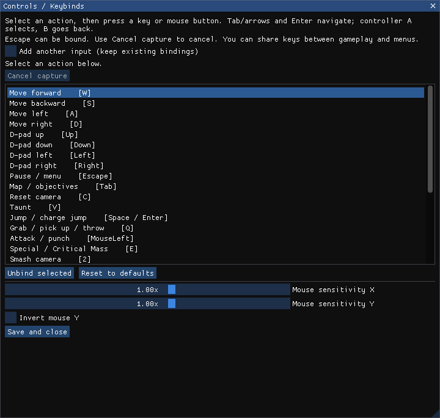
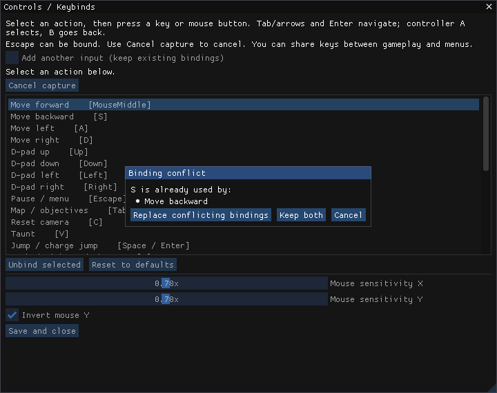
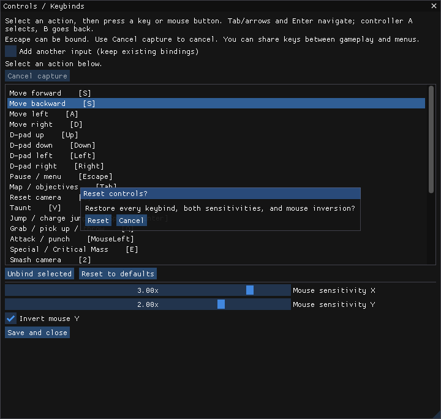

# Controls evidence for issue #17

These are actual renders of `hulk::DrawControls`, the same component used by the game. The test captures Dear ImGui draw commands and rasterizes them on the CPU; the images show the Controls panel region of each tested viewport. They are component captures, not running-game screenshots.

The capture process creates no window, graphics device, game process, or audio device. It sends synthetic events only to ImGui and the component's message handler. It does not use OS input injection or change desktop volume. The capture executable has no XAudio, DirectSound, WinMM, or OpenAL dependency.

Local validation passed: complete EU/USA Release executable and generated-DLL builds; 10/10 CTests; 22/22 interaction assertions at each of 1280 x 720 and 800 x 600. The normal CTest run also executes the expanded Controls interaction test.

## What was exercised

- Separate X and Y sensitivity sliders, plus invert Y.
- Every action remains reachable in the scrollable list.
- Selecting an action and capturing a keyboard key or mouse button.
- Canceling capture without accidentally binding the Cancel click.
- Conflict Cancel, Replace, and Keep both.
- Adding a second input and unbinding an action.
- Reset confirmation restores every binding, both sensitivities, and inversion.
- Save and close invokes saving; Escape closes outside capture.
- Reopening focuses the first action and Enter begins keyboard rebinding.
- Input reports are suppressed while Controls is open and pass through after close.

The visual checks found and fixed a keyboard focus/Enter activation issue on reopen. Action labels now use gameplay names such as Smash camera and Cycle target.

## Images

Default controls and mouse settings, in a 1280 x 720 viewport:



A conflicting key waits for the user's decision, at 800 x 600:



Reset requires confirmation:



Keyboard navigation and capture change the displayed binding:


Additional images: [listening for input](controls-listening.png), [menu and zoom actions after scrolling](controls-menu-zoom.png), [multiple inputs](controls-multiple.png), and [restored defaults at 800 x 600](controls-small.png).

## Reproduce

Build with the project's normal SDK patches and game assets, then run the test target. Choose an output directory on your permitted development drive.

```powershell
cmake --build <build-directory> --target hulk_controls_tests
& <build-directory>/hulk_controls_tests.exe <capture-directory>/1280x720 1280 720
& <build-directory>/hulk_controls_tests.exe <capture-directory>/800x600 800 600
ctest --test-dir <build-directory> --output-on-failure
```

The capture command returns nonzero on a failed check. No capture argument is needed for the normal CTest run. [manifest.json](manifest.json) records PNG hashes and normalized source hashes for the capture inputs. The complete test is in [controls_ui.cpp](../../tests/controls_ui.cpp); the CPU renderer is in [controls_capture.cpp](../../tests/controls_capture.cpp).

## Limits

These checks establish component behavior and layout, not subjective camera feel or a complete game restart. Config serialization/load/save round trips are tested separately; the UI test verifies that its save handler is called. Main/pause Options wiring is tested against the real menu archive by `display_menu_rcf`. The title's camera speed/acceleration limit and default-key guest tooltips remain as described in the PR.
