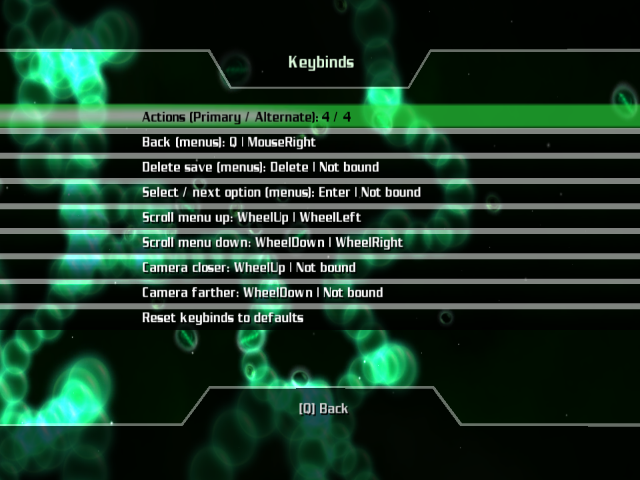
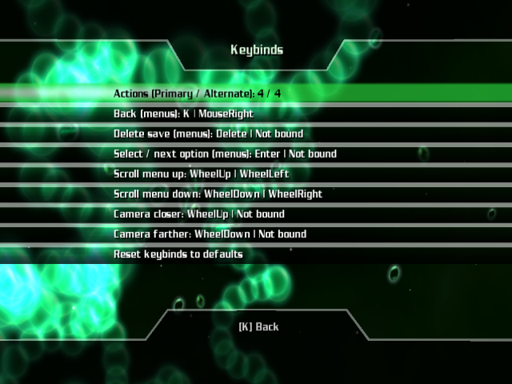
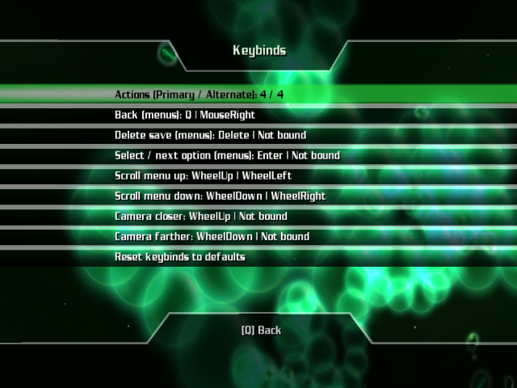

# v0.5.1 verification

The mouse bridge now discards counts above the camera's per-sample limit. Optional smoothing clears on idle and reversal. It does not replay motion after a swipe ends. The native controller/stick path is unchanged.

Keyboard prompt text keeps action templates until the game lays it out and draws it. FEString resolves keys before native wrapping; the native font call also resolves cached footer text. A rebind or reset therefore changes an already-visible hint. Full hints include primary and alternate inputs; the three compact footer slots use the primary. HUD hints use the actual button supplied by the mission script. Controller/PlayStation and map icons keep their original behavior.

## Tests

EU and USA executables/DLLs build. All **14 CTest tests pass**.

- Mouse regressions cover saturated swipes, both axes, immediate idle, reversal, 30/60/120/240 Hz, smoothing on/off, repeated polls, and physical controller input after the mouse stops.
- Hint tests cover all 28 actions/four language columns, alternate/unbound keys, held and movement hints, actual HUD button codes, the same cached text after rebind/reset, native wrapping-cache invalidation, guest allocation/deletion, and native draw arguments/stack restoration.
- Archive tests rebind camera reset to F and target cycling to T, then check their help/tutorial text. Word-only targeting and charged-jump instructions also name the bound keys.
- Existing input, settings, menu/archive, cheat and screen-lifecycle tests still pass.

The mouse and default-key footer regressions failed before the fix. A first live run caught an additional cached-footer case; the regression now reuses the same footer across rebind/reset rather than rebuilding it.

## Native game captures

One hidden, muted EU run used the built executable and a privately built game DLL. It changed Back through the native Controls slot chooser/capture dialog, then used the native reset dialog. No restart or string-table reload occurred.

| Before: Q | After rebinding: K |
| --- | --- |
|  |  |

The bottom hint returns to Q after resetting bindings:



The 166-second run produced seven renderer captures, **1,425 visibility/foreground checks with zero violations**, and no runtime errors. Audio samples were discarded without creating an XAudio2 device. Final TOML values were `menu_back = ['Q', 'MouseRight']` and `jump = ['Space', 'Enter']`.

Images are direct PNG exports of the game's D3D11 `final.bmp` frames, without cropping or redrawing. [Source, binary and image hashes](manifest.json) identify the tested files.

To reproduce from the source checkout with your own extracted assets:

```powershell
.\tools\Test-NativeControls.ps1 -Build 'D:\Projects\Build Cache\Hulk Recompiled\issue17\production' -Replay 'tests\fixtures\live-binding-hints.input'
```

## Limits

The smoke captures are EU menu hints, not a complete mission/tutorial playthrough. USA has build and automated test coverage. Clean first-launch compilation, launcher UI, audio playback, all controllers/renderers and the reporter's hardware were not retested. The game's turning-speed limit still applies while the mouse moves; excess motion is discarded instead of queued. Character-follow/cutscene camera behavior is unchanged.
